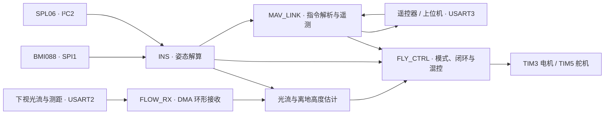

# XUSTBfly_control

基于 **STM32H743VIH6** 和 **FreeRTOS** 的双电机扑翼飞行器控制固件。飞控用 BMI088 解算姿态，通过下视光流与测距模块估计机体前向、右向速度及离地高度。遥控器和上位机通过 MAVLink 提供控制输入，同一链路回传航向角和心跳。

## 工程目录

| 路径 | 内容 |
| --- | --- |
| [Core/](Core/) | 时钟、GPIO、串口、DMA、SPI、I²C、PWM、RTOS 任务创建及中断入口 |
| [application/](application/) | 姿态解算任务、飞行模式和混控、ADRC、MAVLink 收发、光流接收与快照 |
| [algorithm/](algorithm/) | 通用 PID、滤波、光流解算和光流模式参数 |
| [bsp/](bsp/) | BMI088、SPL06、板级 SPI 访问和软件环形缓冲区 |
| [Drivers/](Drivers/) | STM32H7 HAL、CMSIS 及其依赖 |
| [Middlewares/Third_Party/](Middlewares/Third_Party/) | FreeRTOS 10.3.1 和 MAVLink C 头文件 |
| [MDK-ARM/](MDK-ARM/) | Keil 工程、启动汇编与设备调试配置 |
| [fly_control_stm.ioc](fly_control_stm.ioc) | STM32CubeMX 外设及引脚配置 |

## 运行架构



[main.c](Core/Src/main.c) 初始化时钟与外设，启动 MAVLink 接收与 PWM，再创建任务并启动调度器。FreeRTOS 的节拍频率为 1 kHz。下表的延时是任务循环中的等待时间，实际执行间隔还包含本轮处理时间和调度延迟。

| 任务 | 优先级 | 栈大小（32 位字） | 调度与职责 |
| --- | --- | ---: | --- |
| `INS` | High | 256 | 每轮延时 1 tick。读取 BMI088、更新姿态，按循环次数分频处理气压数据 |
| `FLY_CTRL` | Normal | 256 | 每轮延时 1 tick。复制光流快照、选择模式、计算控制量、写入 PWM |
| `FLOW_RX` | Normal | 512 | 接收期间每轮延时 2 tick。读取 USART2 循环 DMA 中的新字节并派发整帧 |
| `MAV_LINK` | Normal | 768 | 每轮延时 10 ms。排空 USART3 软件环形缓冲区，解析指令并按周期发送遥测 |
| `defaultTask` | Normal | 128 | CubeMX 默认任务 |

任务定义见 [freertos.c](Core/Src/freertos.c)，节拍及堆配置见 [FreeRTOSConfig.h](Core/Inc/FreeRTOSConfig.h)。USART2 使用 `MAVLINK_COMM_1` 和 512 字节循环 DMA 缓冲区，接收任务通过 DMA 回绕计数及 NDTR 定位新增字节。USART3 使用 `MAVLINK_COMM_0`，实际接收入口是 `HAL_UART_Receive_IT`，逐字节放入软件环形缓冲区。USART3 当前采用阻塞式串口发送。 [光流接收](application/flow_rx.c) · [DMA 接收实现](application/mavlink_port.c) · [USART3 收发](application/mavlink.c)

## 硬件与接口

| 外设 | 引脚及配置 | 用途 |
| --- | --- | --- |
| MCU | STM32H743VIH6，系统时钟 480 MHz | Cortex-M7 飞控主控 |
| SPI1 | PA5 SCK、PA6 MISO、PD7 MOSI；片选 PC15、PB2 | BMI088 角速度和加速度采集 |
| I²C2 | PB10 SCL、PB11 SDA | SPL06 气压计 |
| USART2 | PD5 TX、PD6 RX，115200 baud，8N1 | 接收下视光流与测距模块的 MAVLink 数据 |
| USART3 | PD8 TX、PD9 RX，460800 baud，8N1 | 接收遥控及上位机指令，发送飞控遥测 |
| TIM3 | CH4 / PB1 左电机，CH3 / PB0 右电机 | 电调 PWM |
| TIM5 | CH2 / PA1 左舵机，CH1 / PA0 右舵机 | 舵机 PWM |

TIM3 和 TIM5 的 PWM 周期均为 20 ms。正常控制时，代码将电机指令映射为 1000–1900 μs 脉宽，将左右舵机指令限制在 500–1300 μs。停机分支写入双电机 1000 μs、双舵机 900 μs。 [外设配置](fly_control_stm.ioc) · [定时器初始化](Core/Src/tim.c) · [执行器输出](application/Aircraft_ctrl_task.c)

## 飞行模式与控制

串口遥控输入取自 `RC_CHANNELS_OVERRIDE`。CH1–CH4 分别作为横滚、俯仰、油门和偏航输入，B、C、E、F 开关分别取自 CH6、CH7、CH5、CH8。下表的 0、1、2 对应固件解码后的开关状态。进入光流模式后，拨到 **B=2、C=0** 可直接切回普通 RUN，右杆恢复给定姿态，基础推力取当前左油门杆位。拨到 **B=0、C=0** 进入停机，其余组合保持光流模式。

| 遥控组合 | 模式 | 控制行为 |
| --- | --- | --- |
| B=0，C=0 | 停机 `Aircraft_ZERO_FORCE` | 电机输出最小脉宽，舵机回中 |
| B=1，C=0 | 光流控速 `Aircraft_FLOW_RUN` | 上位机给定水平速度，进入后可拨到 C=1 允许右杆接管。左横杆调整航向，测距有效且定高开启时跟踪固定离地高度 |
| B=2，C=0 | 手动飞行 `Aircraft_RUN` | 右杆给定姿态，油门杆给定基础推力。E=2 时使用高速操纵参数 |
| B=0，C=2 | `Aircraft_RUN_ADRC` | 保留姿态外环，使用 ADRC 计算三个轴的角速度控制输出 |
| B=2，C=2，E≠2 | 上位机辅助 `Aircraft_Auto` | 上位机提供滚转、俯仰目标及附加推力。遥控器保留基础油门和航向调整 |
| B=2，C=2，E=2 | 俯仰内环调试 | 进入内环调试分支，优先于 Auto |
| B=2，C=1 | 横滚外环调试 | 进入横滚外环参数调试分支 |
| 其余组合 | 停机 | 落入停机分支 |

姿态外环根据角度误差给出目标角速度，角速度内环产生控制量。普通飞行、上位机辅助和光流模式使用 PID 内环。混控用左右电机差动实现横滚，左右舵机差动实现俯仰，同向偏转实现偏航。手动飞行分支还包含横滚配平与试验性翻滚逻辑。 [遥控解码](application/mavlink.c) · [模式与混控](application/Aircraft_ctrl_task.c) · [ADRC](application/adrc.c)

### 姿态解算

INS 对 BMI088 原始读数扣除零偏并转换物理单位，逐轴通过二阶低通，再用 Madgwick 算法更新姿态。当前使用代码内的板级零偏参数。飞控使用欧拉角和角速度反馈，光流与航向遥测通过临界区复制带有效标志和时间戳的 `FlowAttitude_t` 快照。控制内部欧拉角以度为单位，航向遥测以 rad 为单位。 [INS 实现](application/INS_task.c) · [坐标示意图](Diagram%20of%20the%20coordinate%20system.jpg)

### 光流控速与定高

1. 光流估计将 `OPTICAL_FLOW_RAD` 的积分角位移按时间换算为角速度，用机载 IMU 消除镜头旋转造成的视野运动。换算成探头的平移速度后，再扣除探头绕旋转中心运动的速度，结合倾角和旋转中心升降速度，求得沿当前航向的前向、右向速度。
2. 高度估计可由 `OPTICAL_FLOW_RAD.distance` 或 `DISTANCE_SENSOR.current_distance` 更新。探头在旋转中心正下方 5.5 cm，定高使用旋转中心高度，按 `(斜距 + 0.055 m) × cos(roll) × cos(pitch)` 计算。光流速度解算使用 106 帧旋转中心高度的差分补偿升降分量。速度和高度分别低通，并使用独立的有效标志。
3. 水平速度 PID 将前向误差转换为俯仰目标，将右向误差转换为横滚目标。C=1 时，右杆任一轴超出死区便接管两个水平轴，右杆回中后交回上位机。C=0 或 C=2 时，水平速度由上位机给定。由上位机控制时，若从未收到有效指令，或距上一条有效指令已超过 1500 ms，则给定零速度。光流速度观测失效时清除速度 PID，俯仰和横滚目标回到 0°。
4. 高度环用高度误差和垂直速度计算推力。P 项修正高度偏差，D 项抑制实际升降，I 项缓慢修正维持高度所需的基础推力。测距首次有效或恢复时，以当前推力初始化积分并重建速度差分。积分增量设有速率上限，推力限幅或限速时只允许积分朝减轻受限的方向变化。
5. 测距失效时，基础推力按限速过渡到手动油门映射。将 `FLOW_RUN_HEIGHT_ENABLE` 设为 0 可用手动油门保留水平速度控制。

观测有效性受斜距、倾角、积分时间和 IMU 数据时效等条件约束。速度和高度过期或无效时，快照将相应字段置为 `NaN`。光流质量值会保留供调试，当前速度有效性判定依据几何、时间及数值范围。 [观测快照](application/mavlink_flow.c) · [速度与高度解算](algorithm/optical_flow.c) · [闭环实现](application/Aircraft_ctrl_task.c)

## MAVLink 通信

支持 MAVLink common 消息。飞控从 USART3 发送 MAVLink 2，系统 ID 和组件 ID 均为 1。

### 接收消息

| 端口 | 消息 | ID | 处理方式 |
| --- | --- | ---: | --- |
| USART3 | `HEARTBEAT` | 0 | 保存最近一帧的来源系统 ID、组件 ID、心跳载荷、本机接收时间及累计接收数 |
| USART3 | `RC_CHANNELS_OVERRIDE` | 70 | 解析遥控通道、摇杆和开关 |
| USART3 | `SET_ATTITUDE_TARGET` | 82 | 将四元数解算为工程姿态角并保存推力，供 Auto 使用 |
| USART3 | `V2_EXTENSION` | 248 | 光流模式水平速度指令。按下文约定解码前向速度、右向速度、使能和采样时间回显 |
| USART2 | `OPTICAL_FLOW_RAD` | 106 | 光流积分量、积分时间、质量及该帧斜距 |
| USART2 | `DISTANCE_SENSOR` | 132 | 读取 `current_distance`，将厘米换算为米后更新高度 |

### 飞控与电脑的 MAVLink 2 消息

| 方向 | 消息 | 频率 | 无签名帧大小 | 内容 |
| --- | --- | ---: | ---: | --- |
| 飞控 → 电脑 | `DEBUG`（254） | 5 Hz | 21 字节 | `ind=1` 表示 yaw，`value` 为前右下坐标约定的航向角，单位 rad，范围约为 −π 到 π。 `time_boot_ms` 为该姿态快照在飞控上的采样时间 |
| 电脑 → 飞控 | `V2_EXTENSION`（248） | 10 Hz | 最多 27 字节 | 水平速度指令与时间回显 |
| 双向 | `HEARTBEAT`（0） | 各 1 Hz | 各 21 字节 | 系统识别。飞控在启动时立即发一帧 |

上述三类消息的原始流量上限为 `5 × 21 + 10 × 27 + 2 × 21 = 417` 字节/秒。ELRS 封装、重传及其他 MAVLink 消息另计，实际转发需联调验证。姿态快照无效或超过 100 ms 时跳过本次 yaw 遥测。飞控的发送周期由 `MAVLINK_YAW_PERIOD_MS` 和 `MAVLINK_HEARTBEAT_PERIOD_MS` 配置。 [发送实现](application/mavlink.c) · [MAVLink 2 序列化](https://mavlink.io/en/guide/serialization.html)

### 水平速度指令载荷

电脑发送 `V2_EXTENSION` 时，将 `message_type` 设为本工程约定的 **`0x8001`**，`target_network=0`，`target_system=1`，`target_component=1`。飞控也接受目标系统或组件为 0 的广播。以下偏移相对于该消息的 `payload` 数组，所有多字节数值使用小端编码。

| 字节偏移 | 类型 | 含义 |
| --- | --- | --- |
| 0 | `uint8` | 载荷版本，固定为 1 |
| 1 | `uint8` | 使能，0 表示停止，1 表示采用速度指令 |
| 2–3 | `int16` | 期望 `vx`，前向为正，单位 mm/s |
| 4–5 | `int16` | 期望 `vy`，右向为正，单位 mm/s |
| 6–9 | `uint32` | 回显最近一次 `DEBUG.ind=1` 的 `time_boot_ms`。收到第一帧 yaw 前可填 0 |

电脑端可用 Python 的 `struct.pack("<BBhhI", 1, enabled, vx_mm_s, vy_mm_s, echo_ms)` 序列化，再将数组尾部补零至 249 字节交给 MAVLink 2 库。MAVLink 2 打包会裁剪尾部零，飞控按固定布局补回。停止时发送 `enabled=0, vx=0, vy=0`，飞控将上位机的两轴速度目标置零。飞控接收后按本机接收时间判断 1500 ms 超时，回显值记录在 `pc_data.velocity_echo_ms` 供联调。心跳接收可通过 `mavlink_get_heartbeat_snapshot()` 读取。 [指令与心跳解析](application/mavlink.c) · [V2_EXTENSION 消息](https://mavlink.io/en/messages/common.html#V2_EXTENSION)

## 主要调试参数

光流解算、水平速度控制和定高参数集中在 [flow_config.h](algorithm/flow_config.h)。以下是仓库当前默认值，推力指令沿用工程内部量纲。

| 参数 | 当前值 | 用途 |
| --- | ---: | --- |
| `FLOW_RUN_HEIGHT_ENABLE` | 1 | 启用光流定高 |
| `FLOW_RUN_TARGET_HEIGHT_M` | 1.0 m | 旋转中心离地高度目标 |
| `FLOW_RUN_HEIGHT_KP/KI/KD` | 68.0 / 3.0 / 20.0 | 高度 P、I、D 增益，I 按秒积分，D 使用垂直速度 |
| `FLOW_RUN_HEIGHT_I_SLEW` | 3.5 /s | 高度积分项最大变化速率 |
| `FLOW_RUN_THRUST_MAX` | 340 | 混控前的基础推力上限 |
| `FLOW_RUN_THRUST_SLEW` | 250 /s | 混控前基础推力的变化率限制 |
| `FLOW_RUN_XY_MAX_MPS` | 3.0 m/s | 水平速度给定的单轴限值 |
| `FLOW_XY_FILTER_TAU_S` / `FLOW_HEIGHT_FILTER_TAU_S` | 0.02 s / 0.02 s | 水平速度及离地高度的低通时间常数 |
| `FLOW_RUN_VZ_FILTER_TAU_S` | 0.08 s | 高度差分得出的升降速度低通时间常数 |
| `FLOW_MIN_DISTANCE_M` / `FLOW_MAX_DISTANCE_M` | 0.08–4.0 m | 光流估计接受的斜距范围 |
| `FLOW_SENSOR_OFFSET_Z_M` | 0.055 m | 探头沿机体正下方距旋转中心的距离 |
| `FLOW_MIN_TILT_COS` | 0.5 | 高度与光流速度共用的倾角投影系数下限，对应 60° 合成倾角 |
| `FLOW_TIMEOUT_MS` / `FLOW_IMU_TIMEOUT_MS` | 100 ms / 10 ms | 光流与测距有效期、光流解算允许的 IMU 数据年龄 |

Keil 调试器中可查看 `aircraft_control.flow_data` 的原始和滤波后速度、高度及有效位。其 `control` 子结构提供控制目标、PID 输出和执行器 CCR；`PID_flow_height.Iout` 表示当前高度环的积分补偿，`flow_run.thrust` 是限速后的混控前推力指令。比较这些量可以区分测量失效、控制输出饱和和基础推力偏差。

## 编译与上电检查

1. 克隆仓库。私有仓库需要先用有访问权限的 GitHub 账号完成认证。

   ```bash
   git clone https://github.com/HuangGL03/XUSTBfly_control.git
   cd XUSTBfly_control
   ```

2. 使用 Keil MDK-ARM 5 打开 [MDK-ARM/fly_control_stm.uvprojx](MDK-ARM/fly_control_stm.uvprojx)。工程配置使用 ARM Compiler 6.19 和 `Keil.STM32H7xx_DFP.3.0.0` 设备包。
3. 选择 `fly_control_stm` 目标并执行 **Build**。构建输出位于 `MDK-ARM/fly_control_stm/`，其中 `fly_control_stm.axf` 用于调试，`fly_control_stm.hex` 用于烧录。
4. 连接与飞控板匹配的 SWD 调试器，在 Keil 中选择实际使用的调试器及 STM32H743 对应的 Flash 算法，再执行 **Download**。
5. 台架上将遥控置于停机组合并断开动力输出，检查 `HEARTBEAT`、航向角符号和 `V2_EXTENSION` 回显。通过 Keil 查看光流速度与高度，并核对电机与舵机通道及停机脉宽。

[CubeMX 配置](fly_control_stm.ioc) 可用于查阅引脚和外设。任务定义、串口回调和部分外设初始化包含手工修改，重新生成代码时应检查这些文件的差异。

## 当前实现边界

- 光流模式控制的是沿当前航向的水平速度和相对地面的高度。在斜坡或地面高度突变处，测距跟随所观测的地面。光流速度可用性也受地面纹理和光照影响。
- SPL06 已接入采集和参考高度计算，气压高度控制量尚未叠加到电机输出。光流定高使用下视测距。
- 当前模式选择没有独立的遥控断流超时停机判定。光流观测超时和上位机水平速度指令超时分别由各自逻辑处理。
- 高度与姿态增益、IMU 偏置和执行器中位与当前样机有关。更换板卡、机械结构或传感器安装方向后，需重新核对轴向、零偏和输出行程。
